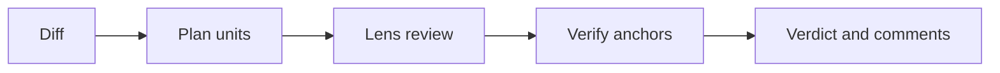

# Tollgate — Enterprise-architect-level AI pull request reviewer

[](./.github/workflows/ci.yml)
[](./LICENSE)

<!-- TODO: replace docs/demo.gif with a recording of a GitHub summary and a Bitbucket Code Insights screenshot. -->


## Why

Security, architecture, and performance issues land in pull requests faster than a human review queue can cover them, and style bots do not cite the standards an organisation actually uses. Platform, security, and architecture teams on GitHub and Bitbucket need a reviewer that checks each change against OWASP, the organisation's own rules, and performance checks, and that publishes a finding only when the code can be anchored to a real line.

## Quickstart

```bash
uv sync --frozen
uv run tollgate standards list
uv run tollgate review --local --base main --dry-run
```

## How it works



The model proposes findings. Verification, ranking, and the verdict are ordinary code. Tollgate never approves a pull request.

## Results

Scripted eval report from `uv run python eval/harness.py` (`eval/reports/latest.json`):

| Lens | Recall | Precision |
|---|---|---|
| architecture | 1.0 | 0.909 |
| llm_security | 1.0 | 1.0 |
| performance | 1.0 | 1.0 |
| security | 1.0 | 1.0 |

41 seeded cases (Python, TypeScript, Java, Go, and C#), 10 clean cases, 0 clean-case false positives at medium or above, 0 inline comments per PR in the scripted run, and 0 USD because the scripted model is unpriced. The critic stays on for high and above; a rejection dismisses the finding so it cannot block.

## Design decisions

- [0001 Config merge](docs/adr/0001-config-merge.md)
- [0002 Tree-sitter](docs/adr/0002-tree-sitter-grammars.md)
- [0003 Unit token budget](docs/adr/0003-unit-token-budget.md)
- [0004 Bitbucket Cloud auth](docs/adr/0004-bitbucket-cloud-auth.md)
- [0005 Bitbucket Data Center 8.19](docs/adr/0005-bitbucket-dc-8-19.md)

## Roadmap

`tollgate serve` queues signed GitHub and Bitbucket webhooks. A live GitHub App review still needs credentials this checkout does not have.

## Licence

Apache-2.0. See [LICENSE](LICENSE).
